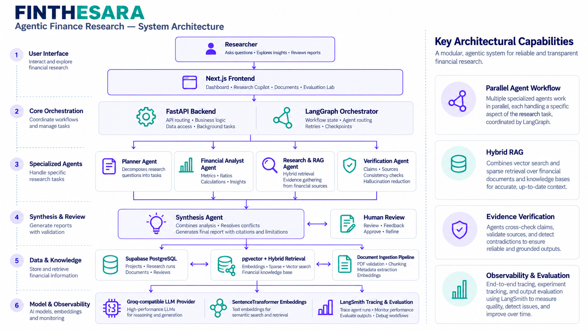
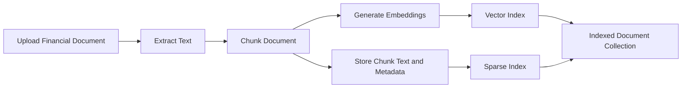
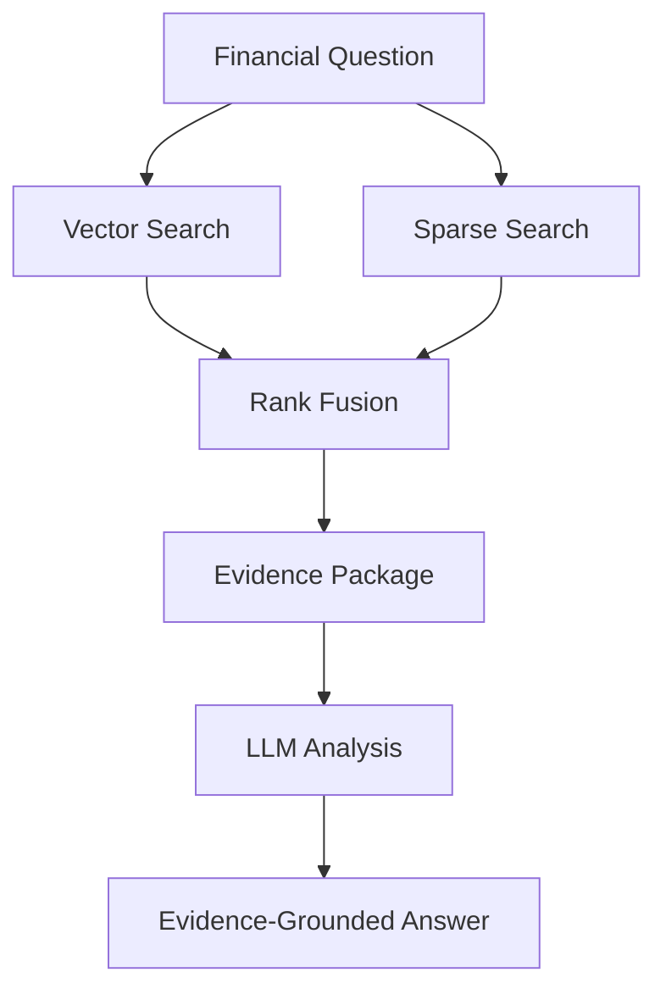

# Finthesara — Agentic Finance Research & Intelligence

**Financial research. Reasoned and verified.**

Finthesara is an AI-powered financial research and intelligence platform designed to help users investigate companies, analyze financial information, retrieve insights from indexed documents, and generate structured research reports grounded in supporting evidence.

Instead of relying on a single LLM response, Finthesara combines **agentic workflows, financial analysis tools, hybrid retrieval-augmented generation (RAG), evidence verification, and observable execution** to create a more structured and traceable financial research experience.

The platform brings together research investigations, document intelligence, financial analysis, and evaluation capabilities in a multi-page web application.

---

## Table of Contents

- [Overview](#overview)
- [Why Finthesara?](#why-finthesara)
- [Core Features](#core-features)
- [System Architecture](#system-architecture)
- [Agentic Research Workflow](#agentic-research-workflow)
- [Technology Stack](#technology-stack)
- [Hybrid RAG Pipeline](#hybrid-rag-pipeline)
- [Financial Analysis](#financial-analysis)
- [Project Structure](#project-structure)
- [Getting Started](#getting-started)
- [Environment Configuration](#environment-configuration)
- [Running the Application](#running-the-application)
- [API Documentation](#api-documentation)
- [Testing and Code Quality](#testing-and-code-quality)
- [Security and Reliability](#security-and-reliability)
- [Current Scope and Limitations](#current-scope-and-limitations)
- [Future Improvements](#future-improvements)
- [Contributing](#contributing)
- [License](#license)

---

## Overview

Financial research often involves collecting information from multiple sources, extracting figures from reports, comparing financial metrics, validating claims, and synthesizing findings into a coherent conclusion.

These tasks can become time-consuming when performed manually. Traditional LLM-based approaches introduce additional challenges, including unsupported claims, missing citations, inconsistent calculations, and limited visibility into how an answer was produced.

Finthesara explores a more structured approach by combining LLM reasoning with specialized agents, retrieval systems, financial tools, and evidence-grounded reporting.

### The objective

Build a financial intelligence workspace where users can:

- Investigate companies and financial research questions.
- Execute structured, multi-step research workflows.
- Upload and index financial documents.
- Ask questions against indexed document collections.
- Analyze reported company fundamentals and financial metrics.
- Inspect retrieved evidence supporting research conclusions.
- Track investigation results and review execution outcomes.
- Evaluate and improve the reliability of AI-generated outputs.

The system is designed around a key principle:

> A useful financial answer should be more than fluent text. It should be traceable to evidence, transparent about uncertainty, and explicit about what the available information does not establish.

---

## Why Finthesara?

Many AI research applications focus primarily on generating an answer. Finthesara focuses on the workflow behind that answer.

| Challenge | Finthesara's approach |
|---|---|
| Complex research questions | Break work into structured research tasks |
| Unstructured financial documents | Extract, chunk, index, and retrieve relevant content |
| Keyword search misses relevant passages | Combine semantic and sparse retrieval |
| Unsupported financial claims | Ground analysis in retrieved evidence and verification |
| Repetitive financial calculations | Use dedicated financial analysis tools where applicable |
| Opaque agent execution | Use structured workflow state and observability integrations |
| Disconnected research activities | Bring investigations, documents, RAG, and financial analysis into one workspace |

These mechanisms improve the structure and inspectability of the research process; they do not guarantee that every generated conclusion is correct.

---

## Core Features

### 1. Agentic financial research

Finthesara uses a graph-based research workflow to coordinate multiple stages of a financial investigation.

The workflow is designed to support:

- Research question planning and decomposition.
- Identification of companies, reporting periods, and required metrics.
- Delegation of research tasks to specialized agents.
- Financial data analysis and document-grounded research.
- Verification of findings against available evidence.
- Final report synthesis.

The graph-based architecture makes it possible to represent dependencies and execution state explicitly instead of treating every request as a single, unstructured prompt.

### 2. Multi-agent architecture

The backend separates research responsibilities into specialized components.

| Agent or component | Responsibility |
|---|---|
| Planner | Converts the research question into a structured plan |
| Financial Analyst | Performs financial analysis using typed financial tools and available data sources |
| Research and RAG | Retrieves and analyzes relevant indexed-document evidence |
| Verification | Supports validation of research claims and findings |
| Synthesis | Combines research outputs into a structured report |

The workflow coordinates these components using shared research state and graph-based execution.

The precise agents and tools invoked depend on the request and the workflow path.

### 3. Hybrid retrieval-augmented generation

The document intelligence layer combines semantic vector retrieval with sparse retrieval.

- **Vector retrieval:** Finds passages based on semantic similarity.
- **Sparse retrieval:** Finds relevant passages using lexical or term-based matching.
- **Rank fusion:** Combines retrieval rankings to improve the relevance of the final evidence set.
- **Project-scoped retrieval:** Restricts searches to the selected project.
- **Evidence packaging:** Preserves relevant document and chunk metadata for downstream analysis.

Retrieved passages provide context to the language model, allowing answers to be grounded in the indexed material rather than generated solely from model knowledge.

### 4. Document intelligence

The platform supports a document ingestion pipeline for financial research materials.

The pipeline is designed to support:

1. Document upload.
2. Text extraction, including PDF processing.
3. Text chunking.
4. Embedding generation.
5. Storage of document and chunk metadata.
6. Indexing for semantic and sparse retrieval.
7. Retrieval of relevant passages during analysis.

The quality of extraction and retrieval depends on document structure, source quality, indexing status, and the relevance of the question.

### 5. Financial analysis workbench

Finthesara provides two complementary analysis modes.

**Ticker-based analysis**

- Accepts a company ticker.
- Supports a reporting-period selection.
- Uses an SEC-backed financial data source.
- Presents returned metrics and available source links.
- Supports financial analysis through the dedicated backend tools.

**Indexed-document analysis**

- Uses the currently selected project.
- Accepts a user-defined financial question.
- Retrieves relevant passages from indexed documents.
- Generates a report grounded in the retrieved evidence.
- Displays retrieved evidence and associated metadata.

The two modes serve different purposes: ticker-based analysis retrieves financial data from its configured source, while indexed-document analysis uses the evidence available in the selected project's document collection.

### 6. Evidence-grounded reports

Research outputs can include findings, supporting evidence, calculations, and limitations.

The document-analysis experience exposes retrieved evidence alongside the generated report, making it easier to inspect the information used by the model.

A reliable research process should distinguish among:

- Figures explicitly reported by a source.
- Metrics calculated from reported figures.
- Interpretations supported by available evidence.
- Questions that cannot be resolved with the available information.

### 7. Research history and investigation workspace

The frontend includes dedicated areas for research activities, including:

- Dashboard.
- New investigation.
- Research history.
- Investigation details.
- Documents.
- Research copilot.
- Financial analysis.
- Evaluations.
- Settings.

This separation keeps investigation execution, document retrieval, and financial analysis distinct while allowing them to share the same application environment.

### 8. Observability and evaluation

Finthesara integrates LangSmith configuration for tracing and inspecting LLM-related workflows.

The project also includes an evaluation area intended to support systematic assessment of AI-generated results.

Observability and evaluation are important because a workflow that produces a plausible answer is not necessarily a workflow that retrieves the right evidence, calculates correctly, or handles uncertainty appropriately.

---

## System Architecture

Finthesara combines multi-agent orchestration, hybrid retrieval-augmented generation (RAG), financial analysis, evidence verification, and observability in a modular architecture.



High-level architecture illustrating the frontend, FastAPI backend, LangGraph orchestration, specialized research agents, document retrieval, data storage, and model observability.

### Architectural responsibilities

| Layer | Responsibility |
|---|---|
| Frontend | User interface, project selection, forms, result rendering, and research navigation |
| API | Request validation, endpoint handling, and coordination with backend services |
| Agent orchestration | Research planning, task execution, state management, and synthesis |
| Retrieval | Semantic search, sparse search, rank fusion, and evidence packaging |
| Data layer | Project, document, chunk, and application data persistence |
| LLM integration | Model-powered planning, evidence analysis, and synthesis |
| Observability | Inspection of supported model and workflow execution |

The diagram represents the intended high-level architecture. Actual execution paths depend on the endpoint and workflow configuration.

---

## Agentic Research Workflow

A typical investigation follows a structured sequence.

### Step 1 — Research request

The user submits a financial research question through the frontend.

The backend validates the request and establishes the context required to execute the investigation.

### Step 2 — Planning

The planner converts the question into a structured research plan containing relevant companies, metrics, tasks, and completion criteria.

This plan provides a clearer execution contract than passing the original question independently to every component.

### Step 3 — Task execution

Specialized components handle the work appropriate to each task.

Examples include:

- Retrieving financial evidence.
- Analyzing indexed documents.
- Obtaining supported financial metrics.
- Performing deterministic calculations.
- Collecting information required to evaluate a claim.

### Step 4 — Evidence retrieval and analysis

The retrieval pipeline finds relevant passages from the selected project's indexed documents.

Retrieved evidence is passed to the relevant analysis components with source and chunk metadata where available.

### Step 5 — Verification

The verification stage supports checking findings against the information collected during research.

Verification quality depends on the available evidence and the implemented verification rules; it should not be interpreted as a guarantee that every statement is independently confirmed.

### Step 6 — Synthesis

The synthesis component combines available findings into a coherent report.

The report should preserve important qualifications and avoid presenting unavailable figures as established facts.

### Step 7 — Review

The user can inspect the final report and, where exposed by the interface, review supporting evidence and investigation details.

---

## Technology Stack

### Frontend

| Technology | Purpose |
|---|---|
| Next.js | Application framework and page routing |
| React | Interactive user interface |
| TypeScript | Static typing |
| Tailwind CSS and project UI styles | Interface styling |
| Lucide React | Interface icons |
| React Markdown | Markdown report rendering |
| Supabase browser client | Authentication integration where configured |

### Backend

| Technology | Purpose |
|---|---|
| Python 3.12+ | Backend runtime |
| FastAPI | REST API framework |
| Uvicorn | ASGI server |
| LangGraph | Stateful agent workflow orchestration |
| LangChain ecosystem | LLM and retrieval integration |
| Pydantic | Request validation and typed data models |
| Pydantic Settings | Environment-based configuration |
| SQLAlchemy / asyncpg | Database integration components |
| PyMuPDF | PDF text extraction |
| Ruff | Python linting |
| Mypy | Static type checking |
| Pytest | Automated tests |

### AI and retrieval

| Technology | Purpose |
|---|---|
| Groq-compatible LLM API | Language-model inference |
| Sentence Transformers | Text embedding generation |
| `BAAI/bge-base-en-v1.5` | Configured embedding model |
| PostgreSQL with pgvector | Vector storage and similarity retrieval |
| Sparse retrieval | Lexical matching |
| Rank fusion | Combining retrieval rankings |
| LangSmith | LLM and workflow observability |

### Infrastructure and persistence

- Supabase PostgreSQL.
- pgvector for vector similarity search.
- Environment-based configuration.
- Git and GitHub for version control.
- Separate frontend and backend development servers.

Exact package versions should be taken from the project's dependency manifests and lockfiles.

---

## Hybrid RAG Pipeline

Hybrid RAG is a core component of Finthesara's document-grounded analysis.

### Ingestion flow



### Retrieval flow



The hybrid approach is useful because semantic and lexical search have different strengths.

For example, semantic retrieval may identify a passage discussing liquidity even when the question uses different wording. Sparse retrieval may help locate an exact financial metric, reporting period, or technical term.

Combining the two approaches can improve retrieval coverage, although retrieval quality still requires evaluation against representative financial questions.

---

## Financial Analysis

Finthesara separates financial analysis from general document question answering.

### Ticker-based mode

This mode queries the configured SEC financial data source using a ticker and reporting-period selection.

It is intended to present available company fundamentals and associated source information.

The availability of a particular metric depends on the source data and supported reporting period.

### Indexed-document mode

This mode sends a project-scoped request to the document-analysis endpoint:

`POST /api/v1/financial-analysis/documents`

Example request:

```json
{
  "project_id": "YOUR_EXISTING_PROJECT_UUID",
  "question": "Analyze the company's revenue, net income, cash, debt, and profit margins.",
  "top_k": 10
}
```

Replace the example project ID with an existing project ID in your environment.

The endpoint retrieves evidence from the selected project's indexed documents and uses the retrieved passages to generate a financial analysis.

The response includes the question, generated answer, evidence, result count, and retrieval information when available.

### Calculation principles

Financial analysis should follow these principles:

- Use compatible reporting periods and units.
- Distinguish reported values from derived values.
- Show calculation formulas and inputs when computing metrics.
- Avoid calculating ratios when required inputs are unavailable.
- Identify missing or inconsistent data.
- Preserve source references where available.

For example, revenue growth can be calculated as:

\[
\text{Revenue Growth (\%)} =
\frac{\text{Current Revenue} - \text{Previous Revenue}}
{\text{Previous Revenue}} \times 100
\]

The formula is valid only when both revenue values refer to comparable reporting periods and units.

---

## Project Structure

The repository separates frontend code, backend services, and database assets.

```text
agentic-finance-research/
├── frontend/
│   ├── src/
│   │   ├── app/
│   │   │   ├── dashboard/
│   │   │   ├── documents/
│   │   │   ├── evaluations/
│   │   │   ├── financial-analysis/
│   │   │   ├── rag/
│   │   │   ├── research/
│   │   │   ├── settings/
│   │   │   └── ...
│   │   ├── components/
│   │   │   ├── projects/
│   │   │   └── ui/
│   │   └── lib/
│   ├── package.json
│   └── .env.local
│
├── backend/
│   ├── app/
│   │   ├── agents/
│   │   ├── api/
│   │   │   └── v1/
│   │   ├── graph/
│   │   ├── llm/
│   │   ├── retrieval/
│   │   ├── tools/
│   │   └── ...
│   ├── tests/
│   ├── pyproject.toml
│   └── ...
│
├── supabase/
│   └── migrations/
│
├── AGENTS.md
├── README.md
└── ...
```

This is a representative overview rather than a complete listing of every file. Refer to the repository for the exact current structure.

---

## Getting Started

### Prerequisites

Install the following before running the application:

- Python 3.12 or a compatible version supported by the backend configuration.
- Node.js and npm compatible with the frontend's Next.js requirements.
- A Supabase project with the required database schema and extensions.
- A Groq-compatible API key for the configured LLM provider.
- Git.

Optional integrations, such as LangSmith tracing, require their own configuration.

### 1. Clone the repository

```bash
git clone https://github.com/Sukhsimransingh1/agentic-finance-research.git

cd agentic-finance-research
```

### 2. Configure the backend

Navigate to the backend directory:

```bash
cd backend
```

Create a Python virtual environment:

```bash
python3.12 -m venv .venv
```

Activate it on Linux or macOS:

```bash
source .venv/bin/activate
```

Activate it on Windows Command Prompt:

```cmd
.venv\Scripts\activate.bat
```

Install the backend dependencies using the project's dependency manifest and lockfile. For example, if the project is configured for installation through `uv`:

```bash
uv sync --locked
```

If your checkout uses a different dependency-installation workflow, follow the instructions in its `pyproject.toml` and lockfile.

### 3. Configure environment variables

Use the backend's existing `.env.example` as the template for your local environment.

Create the local environment file expected by the application, typically:

```text
backend/.env
```

Populate it with the configuration required by your checkout, including:

- Supabase/PostgreSQL connection settings.
- Groq-compatible LLM provider credentials and model settings.
- LangSmith tracing configuration, if enabled.
- Application environment and other required settings.

Do not commit `.env` files or expose API keys in the frontend.

### 4. Configure the database

Before running the full application, ensure the configured Supabase database is reachable and that the required schema and vector extension are installed.

Review the SQL migration files in:

```text
supabase/migrations/
```

Apply the migrations according to the project's database setup instructions.

Verify that the configured database URL, credentials, permissions, and required tables are correct before testing document ingestion or retrieval.

### 5. Start the backend

From the backend directory, activate the virtual environment and run:

```bash
python -m uvicorn app.main:app --reload --host 127.0.0.1 --port 8000
```

If the application's ASGI entry point differs in your checkout, use the module path configured by the project. The development server will generally be available at:

- API base: `http://127.0.0.1:8000`
- Swagger UI: `http://127.0.0.1:8000/docs`
- ReDoc: `http://127.0.0.1:8000/redoc`

### 6. Configure the frontend

Open a second terminal and navigate to the frontend:

```bash
cd frontend
```

Install dependencies:

```bash
npm ci
```

Create `frontend/.env.local` using the environment variables required by the current frontend configuration.

For a local backend, the API settings may use:

```dotenv
NEXT_PUBLIC_API_BASE_URL=http://127.0.0.1:8000
NEXT_PUBLIC_API_PREFIX=/api/v1
```

Configure any additional required project and authentication variables according to the current application setup. Use an existing project ID when the application requires a default project.

Only values intended for browser exposure should use the `NEXT_PUBLIC_` prefix. Never place private database credentials or LLM API keys in frontend environment variables.

### 7. Start the frontend

Run:

```bash
npm run dev
```

Open:

`http://localhost:3000`

The frontend and backend must both be running for API-backed features to work.

---

## Environment Configuration

Environment variable names can differ between branches and deployments. Use the repository's `.env.example`, Pydantic Settings configuration, and frontend API client as the source of truth.

The following table describes the configuration categories to check.

| Configuration | Purpose |
|---|---|
| Database connection | Connects the backend to PostgreSQL/Supabase |
| LLM provider API key | Enables configured language-model requests |
| LLM model name | Selects the configured inference model |
| Embedding model | Controls document embedding generation |
| LangSmith API key | Enables configured tracing |
| LangSmith project | Organizes observability traces |
| Frontend API base URL | Points the frontend to the backend |
| Frontend API prefix | Configures the API route prefix |
| Default project ID | Supplies a default project where required |
| Supabase browser configuration | Supports configured frontend authentication |

Use the exact environment variable names defined in your checkout rather than assuming that similarly named settings are interchangeable.

### Configuration checklist

- [ ] Database connection succeeds.
- [ ] Required database migrations have been applied.
- [ ] LLM credentials are configured on the backend.
- [ ] Embedding model configuration matches the ingestion pipeline.
- [ ] Frontend API URL matches the running backend.
- [ ] The selected project exists and is accessible.
- [ ] Authentication and database policies match the deployment setup.
- [ ] Optional observability credentials are configured if tracing is enabled.

---

## API Documentation

FastAPI's interactive documentation is the recommended starting point for exploring the endpoints exposed by the running backend.

Open:

`http://127.0.0.1:8000/docs`

The exact route list depends on the current application configuration.

### Key API areas

| API area | Purpose |
|---|---|
| Health | Checks backend availability |
| Projects | Supports project management and selection |
| Research | Executes research investigations |
| Research history | Retrieves persisted investigation information |
| Documents | Handles document ingestion and related operations |
| RAG | Provides document-grounded question answering where configured |
| Financial analysis | Provides ticker-based and indexed-document analysis where configured |
| Human review | Supports review-related workflow operations where configured |

### Indexed-document analysis

Endpoint:

`POST /api/v1/financial-analysis/documents`

Example request:

```json
{
  "project_id": "YOUR_EXISTING_PROJECT_UUID",
  "question": "Summarize the available financial performance metrics and identify missing information.",
  "top_k": 10
}
```

Typical response fields include:

- `project_id`
- `question`
- `answer`
- `evidence`
- `result_count`
- `retrieval_config`, when returned by the endpoint

The response schema and validation behavior are defined by the backend implementation.

---

## Testing and Code Quality

Finthesara uses automated testing and static analysis to help maintain the backend and frontend.

### Backend tests

From the backend directory, activate the virtual environment and run:

```bash
python -m pytest
```

### Python linting

```bash
ruff check .
```

### Python type checking

```bash
mypy app
```

### Frontend linting

From the frontend directory:

```bash
npm run lint
```

### Frontend production build

```bash
npm run build
```

The production build checks compilation, TypeScript, and Next.js page generation. A successful build does not necessarily mean that every ESLint rule passes, so linting should be run separately.

### Suggested validation workflow

1. Run backend tests.
2. Run Python linting and type checking.
3. Run frontend linting.
4. Run the frontend production build.
5. Test project selection and API connectivity.
6. Upload a supported document and verify its indexing status.
7. Ask a question whose answer is present in the indexed document.
8. Inspect the evidence returned by the retrieval pipeline.
9. Test missing-data and error scenarios.
10. Confirm that generated reports do not invent unsupported figures.

---

## Security and Reliability

Financial research applications require careful handling of credentials, source data, and generated claims.

### Secrets management

- Store LLM API keys and database credentials in server-side environment variables.
- Never commit private `.env` files.
- Never expose backend API credentials through `NEXT_PUBLIC_` variables.
- Rotate credentials if they are accidentally exposed.

### Database and access control

- Use the intended authentication and authorization configuration.
- Apply appropriate Supabase Row Level Security policies where required.
- Validate project ownership and access on protected operations.
- Restrict access to project data and indexed documents.
- Use least-privilege database credentials.

### Document ingestion

- Validate supported file types and file sizes.
- Handle extraction failures explicitly.
- Preserve document and chunk identifiers.
- Treat document text as untrusted input.
- Avoid allowing embedded document instructions to override system or application instructions.

### Financial accuracy

- Ground document analysis in retrieved evidence.
- Distinguish source-reported figures from calculations.
- Check units and reporting periods before comparing values.
- Avoid fabricating unavailable metrics or source URLs.
- Identify limitations when evidence is insufficient.
- Treat model-generated analysis as research assistance rather than a substitute for independent verification.

### Observability

Tracing can help diagnose workflow failures, retrieval problems, and model behavior. Logs and traces should not contain API keys, passwords, or unnecessary sensitive information.

---

## Current Scope and Limitations

Finthesara is an evolving research platform. Its behavior depends on the available data sources, configured models, database setup, and implemented workflows.

Important considerations include:

- Financial metrics may be unavailable for certain companies or reporting periods.
- Document analysis is limited by the quality of extraction, indexing, and retrieval.
- A relevant retrieved passage does not automatically prove that every generated interpretation is correct.
- Model responses may require retries or reduced context when provider limits are reached.
- External financial data coverage depends on the configured source integrations.
- Observability and evaluation integrations require their respective configuration and instrumentation.
- Features exposed by the frontend may have different levels of implementation maturity.

Users should inspect source evidence and independently verify material financial conclusions before relying on them.

---

## Future Improvements

Potential directions for continued development include:

- More comprehensive financial statement extraction and normalization.
- Stronger deterministic validation of financial ratios and growth calculations.
- Better document-level filtering and evidence selection.
- Improved citation coverage and claim-to-evidence mapping.
- Automated retrieval and generation evaluation suites.
- Expanded company and financial data source integrations.
- More robust handling of provider rate limits and transient failures.
- Workflow-level metrics and agent execution visualizations.
- Richer report exports and reproducible analysis histories.
- More extensive end-to-end tests across ingestion, retrieval, and analysis.

These items represent possible improvements, not a claim that every capability is already implemented.

---

## Contributing

Contributions, bug reports, and suggestions are welcome.

A useful contribution process is:

1. Identify the behavior or problem to address.
2. Reproduce the issue with a small test case.
3. Implement the change in the appropriate frontend, backend, retrieval, or workflow module.
4. Add or update tests where appropriate.
5. Run the relevant lint, type-check, test, and build commands.
6. Document new environment variables, endpoints, and operational requirements.
7. Submit a focused pull request with a clear explanation of the change.

Keep changes modular, preserve existing API contracts unless a change is intentional, and avoid committing secrets or generated local artifacts.

---

## License

Add the project's chosen license before distributing or reusing this repository. Until a license is explicitly included, do not assume that the code is available for unrestricted reuse.

---

## Project Links

- **GitHub:** https://github.com/Sukhsimransingh1/agentic-finance-research
- **Documentation:** Start with this README and the interactive FastAPI documentation at `/docs` when the backend is running.

---

**Finthesara — Financial research. Reasoned and verified.**
